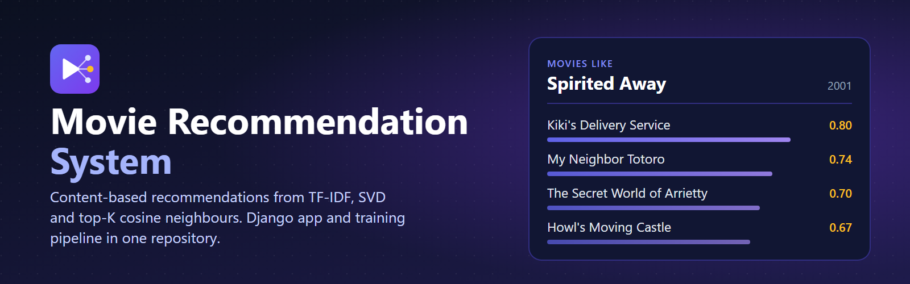
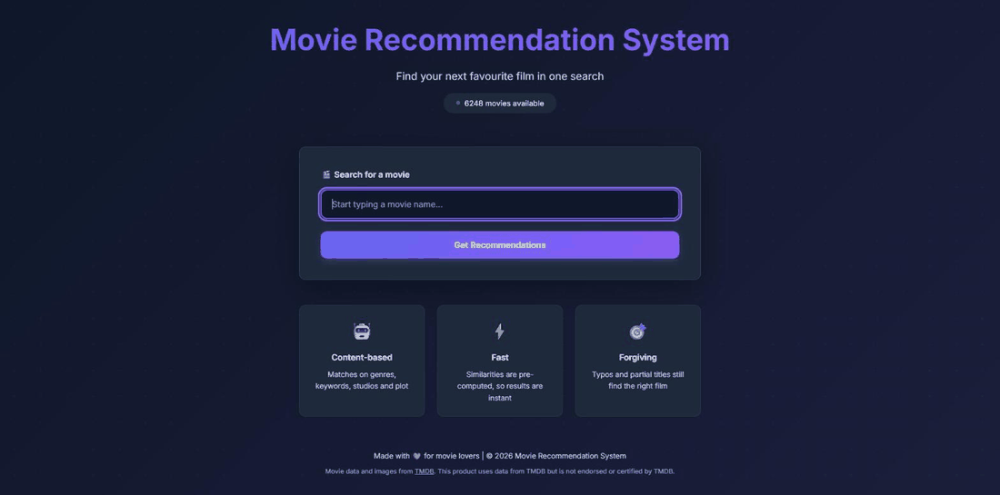
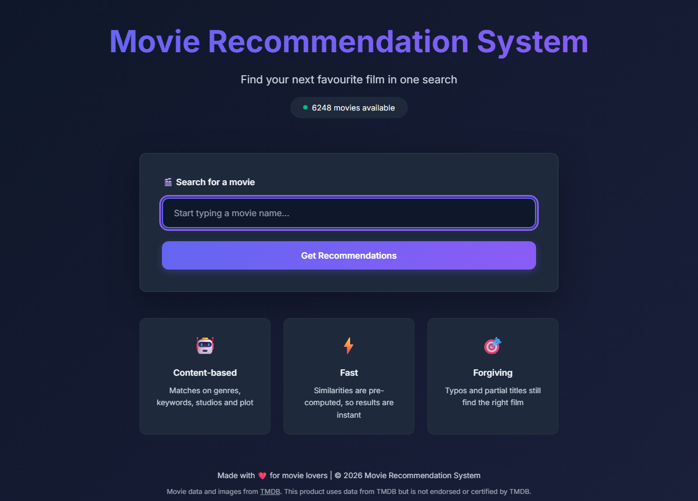
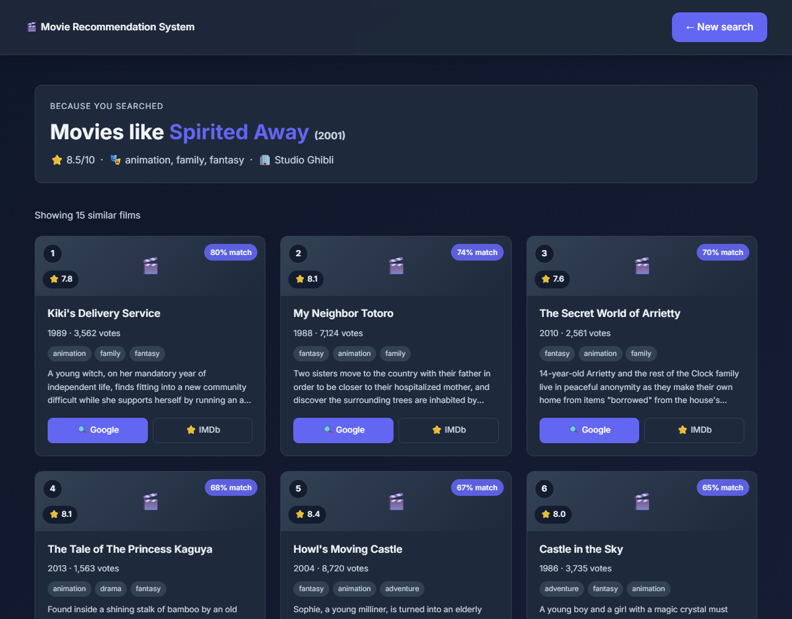

<div align="center">


# Movie Recommendation System

**A content-based movie recommender you can run, train and deploy.**<br>
TF-IDF, SVD and top-K cosine neighbours behind a Django app, with a training pipeline that scales from a few thousand films to the full TMDB catalogue.

[](https://github.com/inboxpraveen/Movie-Recommendation-System/actions/workflows/ci.yml)
[](https://www.python.org/)
[](https://djangoproject.com/)
[](LICENSE)
[](https://github.com/sponsors/inboxpraveen)

</div>



## Contents

- [What it is](#what-it-is)
- [Demo](#demo)
- [How it works](#how-it-works)
- [Quick start](#quick-start)
- [Use it your way](#use-it-your-way)
- [Model training](#model-training)
- [API reference](#api-reference)
- [Configuration](#configuration)
- [Deployment](#deployment)
- [Performance](#performance)
- [Project structure](#project-structure)
- [Documentation](#documentation)
- [Contributing](#contributing)
- [Sponsor](#sponsor)
- [Data and attribution](#data-and-attribution)
- [License](#license)

## What it is

Type a film you like, get fifteen that are close to it. Similarity comes from what the films are made of: genres, keywords, studios, countries, plot overview and tagline. There is no user history to collect, so it works from the first query.

The repository holds two things that work together:

- **A training pipeline** (`training/train.py`) that turns any TMDB-shaped CSV into a small, fast model directory.
- **A Django app** that serves that model: search with autocomplete, ranked results, and a JSON API.

A 6,248-movie demo model is committed in `demo_model/`, so a fresh clone or a fresh deploy works with no setup.

**Why it is easy to run in production**

- **Small models.** The trainer stores the 50 nearest neighbours per film, never an N x N matrix. At 50,000 films that is about 20 MB instead of 10 GB.
- **No code execution when loading.** The app reads parquet, JSON and NumPy arrays. Nothing loaded at serving time is a pickle.
- **Low memory.** Neighbour arrays are memory-mapped, so each request reads one row.
- **Safe to deploy.** The app refuses to start with the development secret key when `DEBUG=False`, and `/api/health/` reports `starting` while a large model loads so platform health checks do not kill the deploy.
- **Tested.** A test suite covers the views, the model loader and the training pipeline.

## Demo



| Search | Results |
|--------|---------|
|  |  |

## How it works


**Training (offline)**

1. Load a TMDB-shaped CSV.
2. Keep released films above a vote threshold (`low` is 5 votes, `medium` is 50, `high` is 500), drop duplicate titles and rows with no usable text.
3. Build one text field per film: genres (counted twice), stemmed keywords, the lead studio (counted twice) plus up to three studios, up to two countries, the first 50 words of the overview, and the tagline.
4. Fit TF-IDF over one and two word grams, then reduce with truncated SVD to 500 dimensions.
5. Compute cosine similarity in 1,024-row chunks and keep the top 50 neighbours per film.

**Serving (online)**

1. The model loads once per process in a background thread; the UI polls `/api/model-status/` for progress.
2. A search is resolved to a title by exact match, then prefix, then substring, then fuzzy match.
3. The film's row of precomputed neighbours is read from the memory-mapped arrays and rendered as cards.

## Quick start

Requires Python 3.11 or newer.

```bash
git clone https://github.com/inboxpraveen/Movie-Recommendation-System.git
cd Movie-Recommendation-System

python -m venv venv
source venv/bin/activate          # Windows: venv\Scripts\activate
pip install -r requirements.txt

python manage.py migrate
python manage.py runserver
```

Open <http://localhost:8000>. Search works immediately because `demo_model/` is found automatically.

Prefer conda?

```bash
conda create -n movierec python=3.12 numpy scipy pandas pyarrow
conda activate movierec
pip install -r requirements.txt
python manage.py migrate && python manage.py runserver
```

## Use it your way

**Run it as a product.** Deploy the app as is, or point `MODEL_DIR` at your own model. See [Deployment](#deployment).

**Use it as a pipeline.** Train on your own catalogue and ship the output directory. Any CSV with TMDB-style columns works. See [Model training](#model-training).

**Use the model from your own code.** The inference class works without Django and supports year, genre and rating filters:

```python
from training.infer import MovieRecommender

rec = MovieRecommender("demo_model")
result = rec.get_recommendations(
    "The Dark Knight", n_recommendations=5, min_year=2010, min_rating=7.0
)
for movie in result["recommendations"]:
    print(movie["title"], movie["rating"], movie["similarity_score"])
```

**Use the JSON API.** Autocomplete and health endpoints are documented in the [API reference](#api-reference).

## Model training

Training is optional. The committed demo model covers 6,248 well-known films (500 or more votes). Train your own for a larger catalogue, another language or your own dataset. Download the [TMDB Movies Dataset](https://www.kaggle.com/datasets/asaniczka/tmdb-movies-dataset-2023-930k-movies) (or any CSV with the same columns), then:

```bash
pip install -r requirements-train.txt

# Default: films with 50+ votes, up to 50,000 of them, 50 neighbours each.
# On the TMDB dataset that is about 26,000 films and a 16 MB model.
python training/train.py ./TMDB_movie_dataset_v11.csv -o models

# Smaller and faster: only films with 500+ votes (about 6,000 films, 4 MB)
python training/train.py ./TMDB_movie_dataset_v11.csv -o models -q high -m 10000

python training/train.py --help   # all options
```

From Python:

```python
from training.train import MovieRecommenderTrainer

trainer = MovieRecommenderTrainer(output_dir="./models", n_components=500, top_k=50)
df, neighbors = trainer.train(
    "path/to/your/dataset.csv",
    quality_threshold="medium",   # low, medium or high
    max_movies=50000,
)
```

The [Training Guide](training/guide.md) covers dataset requirements, tuning and sizing in detail.

## API reference

| Endpoint | Method | Description |
|----------|--------|-------------|
| `/` | GET | Search page |
| `/` | POST | Submit a title, render recommendations |
| `/api/search/?q=` | GET | Autocomplete (two or more characters) |
| `/api/model-status/` | GET | Model loading progress |
| `/api/health/` | GET | Liveness and readiness probe |

**Autocomplete**

```http
GET /api/search/?q=matrix
```

```json
{
  "movies": ["The Matrix", "The Animatrix", "The Matrix Reloaded", "The Matrix Revolutions", "The Matrix Resurrections"],
  "count": 5
}
```

**Health**

```http
GET /api/health/
```

```json
{"status": "healthy", "model_loaded": true, "movies_loaded": 6248, "model_dir": "demo_model"}
```

While a model is loading, `status` is `starting` with HTTP 200. If no model is found or loading fails, it is `unhealthy` with HTTP 503.

**Model status**

```json
{"loaded": true, "progress": 100, "status": "ready"}
```

`status` is one of `loading`, `ready`, `missing` or `error`.

The full reference is in [PROJECT_GUIDE.md](PROJECT_GUIDE.md#-api-reference).

## Configuration

Copy `.env.example` to `.env`. Every value has a safe development default.

| Variable | Purpose | Default |
|----------|---------|---------|
| `SECRET_KEY` | Django secret. **Required** when `DEBUG=False`. | development key |
| `DEBUG` | Never `True` in production. | `True` |
| `ALLOWED_HOSTS` | Comma-separated hostnames. **Required** in production. | localhost |
| `CSRF_TRUSTED_ORIGINS` | Origins trusted for HTTPS form posts. | derived on Render |
| `SECURE_SSL_REDIRECT` | Set `False` if nothing in front terminates TLS. | `True` |
| `MODEL_DIR` | Directory holding a trained model. | `demo_model/` is found automatically |
| `MODEL_URL` | Build-time download of a model archive (Render). | unset |
| `RECOMMENDATION_COUNT` | Results per search. | `15` |

The app checks `MODEL_DIR`, then `models/`, `demo_model/` and `static/`, and uses the first directory that holds a complete model.

## Deployment

Deployments work as is: the committed `demo_model/` is found automatically. The options below are only for shipping a larger model.

### Shipping a bigger model

**Option A, replace the demo model.** Train into `demo_model/` and commit it:

```bash
pip install -r requirements-train.txt
python training/train.py ./TMDB_movie_dataset_v11.csv -o demo_model -q high -m 10000
git add demo_model && git commit -m "Update demo model"
```

`models/` is git-ignored so full-size models never enter history, and `*.pkl` is ignored repository-wide, so the retraining artifacts (an SVD pickle can be ten times the rest of the model) are skipped automatically.

**Option B, fetch at build time.** Package a model and upload it as a GitHub Release asset:

```bash
python training/train.py ./TMDB_movie_dataset_v11.csv -o models
tar czf model.tar.gz -C models --exclude='*.pkl' .
```

Set `MODEL_URL` to the asset URL. `render.yaml` downloads and unpacks it at build time. The app never fetches anything at runtime.

### Render

Connect the repository; Render reads `render.yaml`. Set `ALLOWED_HOSTS` for a custom domain and `MODEL_URL` for option B. `SECRET_KEY` is generated for you, and `/api/health/` is the health check.

### Heroku

Uses the `Procfile`. Commit a model (option A) and set config vars:

```bash
heroku config:set DEBUG=False
heroku config:set MODEL_DIR=demo_model
heroku config:set ALLOWED_HOSTS=your-app.herokuapp.com
heroku config:set SECRET_KEY="$(python -c 'import secrets; print(secrets.token_urlsafe(50))')"
```

### Docker

The image bakes in whatever is in `MODEL_DIR` at build time, so train first:

```bash
python training/train.py ./TMDB_movie_dataset_v11.csv -o models
docker build -t movie-recommender .
docker run --rm -p 8000:8000 \
  -e SECRET_KEY="$(python -c 'import secrets; print(secrets.token_urlsafe(50))')" \
  -e ALLOWED_HOSTS=localhost,127.0.0.1 \
  -e SECURE_SSL_REDIRECT=False \
  movie-recommender
```

`SECURE_SSL_REDIRECT=False` is needed when nothing terminates TLS in front of the container; otherwise every request redirects to `https://` and loops.

All three targets run one gunicorn worker with four threads. The model is held per process, so extra workers would multiply memory use; threads provide the concurrency.

### Checklist

- `SECRET_KEY` is set (the app refuses to start with the development key when `DEBUG=False`)
- `DEBUG=False`
- `ALLOWED_HOSTS` includes your domain
- `curl https://your-app/api/health/` returns `"status": "healthy"`

More detail is in [PROJECT_GUIDE.md](PROJECT_GUIDE.md#-deployment).

## Performance

Measured on a developer machine against the TMDB v11 dataset (1.49 million rows), using 300 random titles per model:

| | Demo model (6,248 films) | Default training (26,326 films) | Large (100,000 films) |
|---|---|---|---|
| Recommendations per query, median / p95 | 1.1 ms / 1.6 ms | 1.1 ms / 1.3 ms | 1.1 ms / 1.4 ms |
| Autocomplete, median / p95 | 0.9 ms / 1.0 ms | 1.0 ms / 4.4 ms | 1.1 ms / 15.9 ms |
| Model load | 40 ms | 75 ms | 210 ms |
| Model files served | 3.8 MB | 16.1 MB | 61.5 MB |
| Training time | 31 s | about 1 min | 4.3 min |
| Training peak memory | 2.5 GB | 2.5 GB | 3.9 GB |

The columns come from `-q high -m 10000`, the default `-q medium`, and `-q low -m 100000`. Query times are measured inside the recommender, so they exclude HTTP and template rendering. Recommendation time stays flat because a search reads one precomputed row; only autocomplete, which scans titles, grows with the catalogue. The 2.5 GB floor is mostly reading the 658 MB CSV, not building the model.

## Project structure

```
Movie-Recommendation-System/
├── movie_recommendation/    Django project (settings, urls, wsgi)
├── recommender/             The app: views, templates, tests
├── training/                Pipeline: train.py, infer.py, guide.md, tests
├── demo_model/              Committed demo model (6,248 films, 3.8 MB)
├── assets/                  Logo, header, architecture diagram, screenshots
├── static/                  Application icon
├── Dockerfile  Procfile  render.yaml
├── requirements.txt         Serving dependencies
├── requirements-train.txt   Extra dependencies for training
├── .env.example             Documented environment variables
├── PROJECT_GUIDE.md  CONTRIBUTING.md  CHANGELOG.md
└── .github/workflows/ci.yml Lint, system checks and tests on every push
```

## Documentation

| Topic | Where |
|-------|-------|
| Installation, configuration, troubleshooting | [PROJECT_GUIDE.md](PROJECT_GUIDE.md) |
| Training, tuning, dataset requirements | [training/guide.md](training/guide.md) |
| Development setup and code layout | [CONTRIBUTING.md](CONTRIBUTING.md) |
| Release history | [CHANGELOG.md](CHANGELOG.md) |
| Security reports | [SECURITY.md](SECURITY.md) |

## Contributing

Contributions are welcome. [CONTRIBUTING.md](CONTRIBUTING.md) covers setup, the layout of the code, and the non-obvious things worth knowing before changing the model pipeline. Before opening a pull request, run the same three checks CI runs:

```bash
python manage.py check
python manage.py test
ruff check .
```

Please add a test with a bug fix and note the change under `[Unreleased]` in `CHANGELOG.md`. Questions and bug reports go to [Issues](https://github.com/inboxpraveen/Movie-Recommendation-System/issues).

## Sponsor

This project is maintained by one person. If it saves you time, or you run it somewhere that matters to you, [sponsoring](https://github.com/sponsors/inboxpraveen) helps keep dependencies current, the demo model fresh, and issues answered. Starring the repository and sharing it helps as well.

## Data and attribution

Movie metadata and poster images come from [TMDB](https://www.themoviedb.org/).

> This product uses data from TMDB but is not endorsed or certified by TMDB.

- The committed `demo_model/` is derived from the [TMDB Movies Dataset](https://www.kaggle.com/datasets/asaniczka/tmdb-movies-dataset-2023-930k-movies) and contains titles, overviews, ratings and poster paths that originate from TMDB.
- Poster images load directly from `image.tmdb.org` at render time. None are redistributed in this repository, and the screenshots above are taken with posters turned off for that reason.
- If you extend this project to call the TMDB API directly, their terms require the wording "This product uses the TMDB API but is not endorsed or certified by TMDB" together with the TMDB logo. See [TMDB's terms of use](https://www.themoviedb.org/api-terms-of-use).

The MIT licence covers this project's own source code, not the movie data.

## License

MIT. See [LICENSE](LICENSE).
